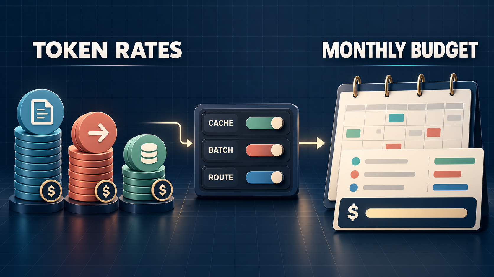
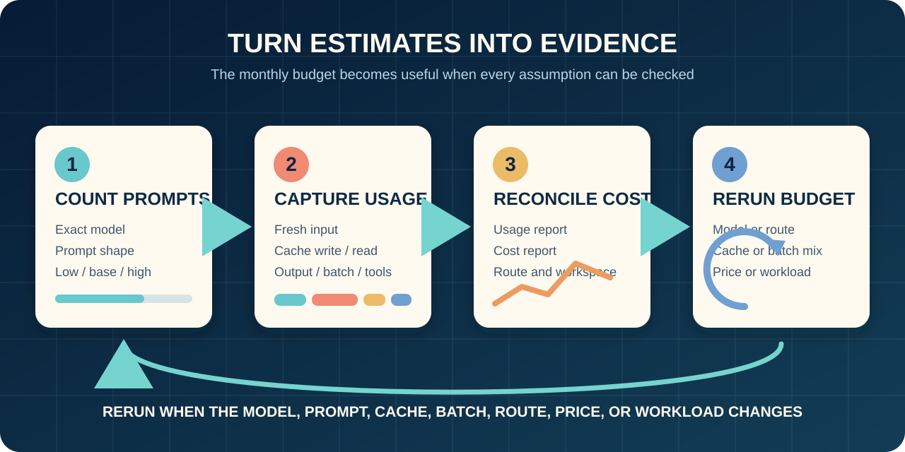

# Claude API Pricing 2026: From Token Rates to a Monthly Budget

*Token-rate categories become a monthly budget only after cache, batch, and route conditions are applied.*

Claude API pricing becomes a monthly budget only after you split the workload into the categories that are actually billed. The calculation also needs repeated context, output length, batch eligibility, routing, tools, and the access route.

Before multiplying anything, record these seven inputs:

1. **Exact model, access route, and price-check date.** An alias or family name is not a rate.
2. **Monthly requests and token mix.** Separate fresh input from output; keep low, base, and high volume cases.
3. **Cache behavior.** Estimate 5-minute writes, 1-hour writes, and reads from observed prefix reuse rather than an assumed discount.
4. **Batch-eligible share.** Only include work that can accept asynchronous execution.
5. **Routing and speed mode.** Record global or US-only inference and any fast-mode use.
6. **Tools and operating overhead.** Include server tools, retries, failed-work policy, and other request-side charges.
7. **Commercial adjustments.** Add taxes, foreign exchange, partner fees, or negotiated terms that apply to your account.

The calculations below use first-party USD list rates checked on October 29, 2026, standard global routing, and non-fast execution unless stated otherwise. They are document-based examples, not an account quote or a record of live requests, cache hits, model quality, latency, or invoices.

## Start with the current Claude API rate card

Anthropic lists rates per million tokens (MTok), but input is not a single price category once caching is involved. The table below transcribes the principal published rates used in this guide from [Anthropic's Claude API pricing page](https://platform.claude.com/docs/en/about-claude/pricing), checked October 29, 2026.

| Model and prompt condition | Input | Output | 5-minute cache write | 1-hour cache write | Cache read |
|---|---:|---:|---:|---:|---:|
| Claude Fable 5.1 | $10.00 | $50.00 | $12.50 | $20.00 | $0.25 |
| Claude Opus 5.5 | $4.00 | $20.00 | $5.00 | $8.00 | $0.20 |
| Claude Sonnet 5.5 | $2.00 | $10.00 | $2.50 | $4.00 | $0.10 |
| Claude Haiku 5.5, prompt ≤100k tokens | $0.10 | $0.50 | $0.125 | $0.20 | $0.01 |
| Claude Haiku 5.5, prompt >100k tokens | $0.50 | $2.50 | $0.625 | $1.00 | $0.05 |

*All amounts are USD per MTok. These are published list rates, not account-specific quotes.*

The Haiku threshold is evaluated per request. All input categories contribute to that request's prompt length. A monthly average below 100,000 input tokens therefore cannot justify the lower tier if some requests cross the threshold. Model-specific tokenization also makes character counts or another model's token count a weak substitute.

These API rates are separate from Claude consumer subscription plans. They also do not automatically include taxes, private discounts, partner-cloud pricing, server-tool charges, US-only inference, or fast mode. Use the table as an input to a workload calculation, not as the monthly answer.

## Build the monthly budget from billable token buckets

Keep every token category on its own row. An "average token price" hides the conditions that determine whether caching and batch apply.

`monthly token subtotal = Σ ((category tokens ÷ 1,000,000) × category rate)`

Use at least these rows:

| Budget row | What to measure | Rate to apply |
|---|---|---|
| Uncached input | New instructions, user content, and non-cached context | Standard input rate |
| 5-minute cache writes | Reusable prefix written with the short TTL | 5-minute write rate |
| 1-hour cache writes | Reusable prefix written with the extended TTL | 1-hour write rate |
| Cache reads | Eligible prefix tokens returned as hits | Cache-read rate |
| Output | Generated tokens, including output from retries you are billed for | Output rate |
| Batch input and output | Eligible asynchronous volume | Applicable batch rates |

Caching is not a blanket percentage reduction. Anthropic's [prompt caching documentation](https://platform.claude.com/docs/en/build-with-claude/prompt-caching) describes exact-prefix matching, minimum cacheable prompt lengths, TTL behavior, and response usage fields. A changing prefix, an expired entry, or parallel requests arriving before a write completes can move expected reads back into input or write categories.

After the token subtotal, add applicable route multipliers and non-token charges:

`monthly total = token subtotal after eligible modifiers + tool charges + retry overhead + route/provider fees + taxes/FX`

Apply a modifier only when the workload meets its conditions. Batch, for example, belongs only to requests that can wait for asynchronous completion. Verify a route's commercial terms instead of copying them from the first-party table. Keep exclusions explicit so the estimate can be reconciled later.

## Worked example: when repeated context changes the monthly total

First, a deliberately simple comparison. Suppose a month contains 10 MTok of ordinary input and 2 MTok of output, with standard global routing, no caching, no batch, and no extra charges.

| Model | Input calculation | Output calculation | Token subtotal |
|---|---:|---:|---:|
| Fable 5.1 | 10 × $10 = $100 | 2 × $50 = $100 | **$200** |
| Opus 5.5 | 10 × $4 = $40 | 2 × $20 = $40 | **$80** |
| Sonnet 5.5 | 10 × $2 = $20 | 2 × $10 = $20 | **$40** |
| Haiku 5.5, every prompt ≤100k | 10 × $0.10 = $1 | 2 × $0.50 = $1 | **$2** |

This only compares list-rate arithmetic. It says nothing about which model meets the task's quality, latency, or reliability threshold.

Now consider a hypothetical Sonnet 5.5 workload with 100,000 requests. Each request contains a 6,000-token reusable prefix, 1,000 tokens of fresh input, and 400 output tokens.

Without caching, that is 700 MTok of input and 40 MTok of output:

`(700 × $2) + (40 × $10) = $1,800`

For a controlled cache scenario, assume exactly 1,000 five-minute writes and 99,000 hits for the reusable prefix:

| Category | Volume | Rate | Subtotal |
|---|---:|---:|---:|
| Fresh input | 100 MTok | $2.00 | $200.00 |
| 5-minute cache writes | 6 MTok | $2.50 | $15.00 |
| Cache reads | 594 MTok | $0.10 | $59.40 |
| Output | 40 MTok | $10.00 | $400.00 |
| **Token subtotal** |  |  | **$674.40** |

The $674.40 figure is not a typical bill or a promised saving. It follows only from the stated hit pattern. More writes, fewer exact-prefix hits, longer output, an ineligible prompt, or another route can reverse the apparent advantage. Measure those quantities before using the scenario in an approval.

## Stress-test the assumptions that can change the budget

Treat each modifier as a condition to prove, not a discount to assume. These are the most important sensitivity checks for a Claude API budget.

| Modifier | What the documentation says | Budget test |
|---|---|---|
| Prompt caching | Writes and reads have distinct rates; hits require eligible, matching prefixes | Measure write/read volumes and hit behavior from usage fields |
| Batch API | Published input and output rates are 50% lower; caching can be combined, but batch cache hits are best-effort | Include only latency-tolerant asynchronous work; model a lower hit case too |
| US-only inference | For Claude 4.6+ models, first-party US-only inference applies a 1.1× token-price multiplier | Confirm whether data-routing requirements justify the premium |
| Fast mode | Uses separate premium rates and is not eligible for batch pricing | Isolate fast traffic rather than blending it into standard volume |
| Long Haiku prompts | Haiku 5.5 moves to a higher tier above 100k input tokens per request | Test prompt-length distribution, not just the monthly average |
| Server tools | Web search is listed at $10 per 1,000 searches plus tokens; web fetch has no separate per-use fee beyond tokens | Log tool invocations and the tokens they introduce |
| Retries and failures | Actual charges depend on what was processed and the applicable policy | Build a measured overhead range instead of assuming zero |
| Tax, FX, discounts, provider fees | Account- and route-specific | Add as separate rows; never bury them in a token rate |

Before launch, use the model-specific [token-counting endpoint documentation](https://platform.claude.com/docs/en/build-with-claude/token-counting) to estimate representative inputs. The estimate can differ from final usage, so preserve the response usage object as the operational record. Recount when the exact model, system prompt, tools, images, documents, or prompt structure changes.

For uncertainty, calculate at least three cases: low volume with optimistic reuse, base volume with observed early-pilot behavior, and high volume with longer output and weaker cache performance. That range is more defensible than a single precise-looking number.

## Choose a model with a cost range, not a price-only verdict

Start the pilot with the least expensive model that might meet a written acceptance threshold, then test that threshold. Published prices can define the budget boundary; they cannot prove task quality, latency, or reliability.

| Workload condition | Sensible pricing shortlist | What must still be tested |
|---|---|---|
| Short, high-volume tasks with strict cost limits | Haiku 5.5, while every prompt stays within the applicable tier | Accuracy, refusal/error behavior, latency, and the >100k risk |
| General product workflows where output cost matters | Sonnet 5.5 | Task success, output-length distribution, cache reuse, and concurrency |
| More demanding tasks where lower-cost models miss the threshold | Opus 5.5 or Fable 5.1 as candidates | Measured improvement relative to the higher input/output price |
| Mixed workload | Route each evaluated task class to its accepted model | Classification errors, fallback volume, and operational complexity |

For every candidate, build low, base, and high cases from the same request set. Vary monthly requests, prompt-length percentiles, output length, cache reads versus writes, batch share, retries, and route charges. Keep product behavior consistent across the cases, and give every changed assumption a reason.

A higher-priced model can still be the better operating choice if it crosses a verified task threshold, reduces human review, or meets an essential latency or reliability requirement. Those are hypotheses to test in the product's evaluation, not benefits to infer from the rate card. Conversely, the lowest list rate is irrelevant if a prompt tier, output pattern, or failure rate makes the real workload more expensive.

Reconsider the shortlist when the model identifier, prompt shape, acceptance criteria, output cap, traffic mix, routing policy, or fallback design changes.

## Replace forecast assumptions with usage and cost evidence

A useful budget has an operating loop: the spreadsheet forecasts, request usage explains workload behavior, and cost reporting supports reconciliation.

*Count representative prompts, capture billable categories, reconcile reported cost, and rerun the budget when workload or route conditions change.*

1. **Count representative prompts before the pilot.** Use the exact model and realistic system instructions, tools, documents, and examples. Save the prompt sample and the date.
2. **Log response usage by workload.** Capture model ID, input tokens, cache-creation tokens, cache-read tokens, output tokens, batch status, tool calls, retries, route, and workspace or project label. Avoid storing sensitive prompt content merely for cost analysis.
3. **Reconcile forecast and reported cost.** Anthropic's [Usage and Cost API documentation](https://platform.claude.com/docs/en/manage-claude/usage-cost-api) describes organization-level usage categories and daily USD cost records. Access requires the appropriate organization credentials, and individual-account reporting does not work identically. The documentation says most data typically appears within about five minutes, so it supports daily or weekly review rather than per-request authorization.
4. **Separate projects and set boundaries.** Anthropic's [workspace documentation](https://platform.claude.com/docs/en/manage-claude/workspaces) describes project separation and monthly workspace spend limits below the organization's limit. A spend limit is a guardrail, not a substitute for application-level rate limits or alerts.
5. **Explain variance, then update the model.** Compare actual category volumes and effective cost with the low/base/high cases. Investigate longer outputs, weak cache hits, unexpected tools, retries, fallback traffic, routing differences, and account-specific charges.

Assign owners: engineering owns instrumentation and prompt changes; the product owner owns traffic and acceptance assumptions; finance or FinOps owns invoice, tax, FX, and contractual reconciliation. Review daily during a new pilot, then move to a cadence that still catches a material drift before the monthly limit becomes the only signal.

## Keep the access route inside the budget

The calculations above use Anthropic's first-party published rate card. They are not a portable quote for a partner cloud, gateway, or aggregator. A different route may change the model identifier, units, caching support, tool charges, provider fees, taxes, billing currency, rate limits, or account eligibility. It may also provide operational value that does not appear in a token-price comparison.

Moduck, the publisher of this article, is an AI API aggregator and unified API platform for developers and product teams. That relationship creates an important boundary: the research for this article did **not** confirm an account-level callable Claude model, current Moduck route price, cache behavior, or billing result. Do not infer Claude availability, first-party price parity, savings, quality, or latency from Moduck's product category or from this article.

Put the route in the worksheet as its own decision field. For every shortlisted route, verify:

- the exact model/version and whether aliases can move;
- input, output, cache-write, cache-read, and batch units;
- route or platform fees and billing currency;
- residency, tool, retry, and fallback treatment;
- current availability, limits, and account prerequisites;
- the usage evidence available for invoice reconciliation.

If an aggregation route is part of your shortlist, inspect Moduck's current documentation before you budget or integrate. [Read the documentation](https://docs.moduck.ai/). Verify the exact Claude model, route, price units, cache treatment, and account conditions for your workload.

## Monthly Claude API budget worksheet

Use one row per workload and model-route pair. If two workloads have different prompt shapes or latency requirements, do not average them together.

| Field | Low case | Base case | High case | Owner / evidence |
|---|---|---|---|---|
| Exact model and route |  |  |  | Pricing page or route documentation |
| Price checked on |  |  |  | Source URL and date |
| Monthly requests |  |  |  | Product forecast / observed traffic |
| Uncached input MTok |  |  |  | Token count and response usage |
| 5-minute write MTok |  |  |  | Response usage |
| 1-hour write MTok |  |  |  | Response usage |
| Cache-read MTok |  |  |  | Response usage |
| Output MTok |  |  |  | Response usage |
| Batch-eligible share |  |  |  | Latency requirement and batch result |
| Routing / fast-mode modifier |  |  |  | Route setting |
| Tool calls and token overhead |  |  |  | Request logs |
| Retries / fallbacks |  |  |  | Request logs |
| Provider fees, tax, and FX |  |  |  | Contract / invoice |
| **Monthly total** |  |  |  | Calculation owner |
| Budget cap and alert level |  |  |  | Workspace/app control |

Approve a pilot budget only when every material bucket has a source, an owner, and a plausible range. Count representative prompts before launch, then replace assumptions with usage and cost evidence. Rerun the comparison when the exact model, alias behavior, provider route, prompt shape, cache policy, batch share, routing mode, tool mix, retry pattern, price, or commercial term changes.

Choose the model and route whose total remains traceable from request behavior to reported cost. Its separately tested operating benefits should justify any verified price difference.

*Research scope: English-language web research checked October 29, 2026. The search sample was not localized to a country, device, account, or personalized results. Rates and terms can change; no API call, account, key, payment, invoice, or production route was tested for this article.*

